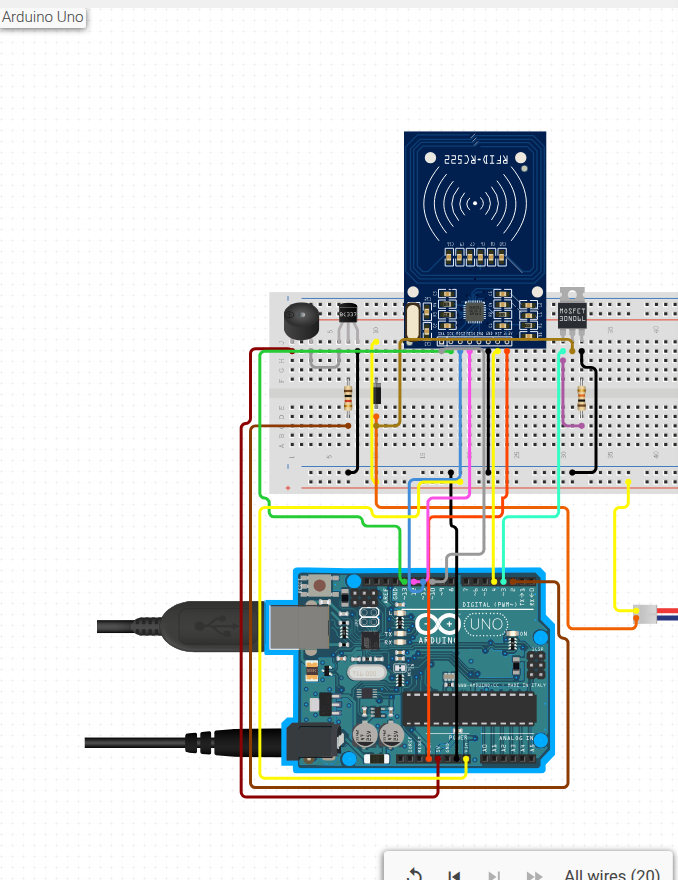
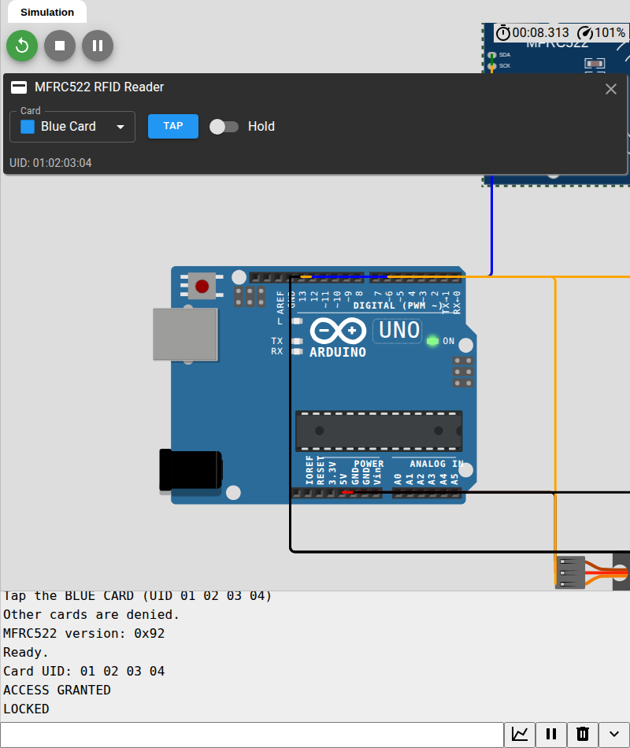

# RFID Door Lock — Arduino Uno + RC522 (Circuito.io)

Project akses pintu dengan **Arduino Uno**, **RFID RC522**, **solenoid lock 12V**, dan **buzzer**. Wiring dan library dasarnya digenerate oleh **circuito.io**; firmware di folder ini mengganti kode test Circuito.io dengan logika akses pintu yang sebenarnya.

> **Mau langsung jalan tanpa hardware?** Pakai [simulator Wokwi](wokwi/README.md) — satu klik, tanpa install, tanpa komponen fisik.

**Circuito.io project (untuk build fisik):**
[https://www.circuito.io/app?components=11021,761981,842876,956215](https://www.circuito.io/app?components=11021,761981,842876,956215)

> Circuito.io menghasilkan **wiring + kode + BOM** untuk build fisik; bukan simulator. Untuk menjalankan **tanpa hardware**, pakai simulator Wokwi di folder [`wokwi/`](wokwi/README.md). Pin map firmware mengikuti solusi Circuito.io; kalau project dibuka ulang dan pin-nya berubah, sesuaikan `#define` di `DoorLock.ino`.



## Jalankan tanpa hardware (Wokwi) — mulai dari sini

Folder [`wokwi/`](wokwi/README.md) berisi simulator yang menjalankan **kode Arduino asli** di browser, tanpa komponen fisik:

- Arduino Uno + MFRC522 virtual
- Kartu RFID virtual (Blue/Green/Yellow/Red/Key Fob/NFC Tag) yang bisa di-tap
- Servo sebagai pengganti latch solenoid
- Buzzer + LED hijau/merah + Serial Monitor

**Langsung buka:** [Wokwi — RFID Door Lock](https://wokwi.com/projects/480509540790761473)

1. Klik **Run** (ikon play hijau).
2. Klik modul **MFRC522** di canvas → pilih **Blue Card** → klik **TAP** (atau tekan **`t`** / nyalakan **Hold**).

Serial Monitor akan menampilkan:

```
Card UID: 01 02 03 04
ACCESS GRANTED
LOCKED
```

Tidak perlu sign in untuk menjalankan. Panduan lengkap ada di [`wokwi/README.md`](wokwi/README.md).



## Cara kerja

1. RC522 terus memindai kartu MIFARE.
2. UID kartu dibandingkan dengan daftar `AUTHORIZED_UIDS` di firmware.
3. **Kartu valid** → dua beep pendek, solenoid unlock selama 3 detik, lalu lock kembali otomatis.
4. **Kartu tidak dikenal** → satu beep panjang, pintu tetap terkunci.
5. Semua UID yang terdeteksi dicetak ke Serial Monitor supaya kartu baru bisa di-enroll.

## Bill of materials

| Komponen | Qty | Catatan |
| --- | --- | --- |
| Arduino Uno R3 | 1 | Board utama |
| RFID RC522 13.56 MHz | 1 | **3.3V only**, komunikasi SPI |
| Solenoid lock 12V (lock-style) | 1 | Fail-secure: terkunci saat tidak diberi daya |
| N-channel MOSFET 60V 30A | 1 | Low-side switch solenoid; gunakan tipe logic-level |
| Diode 1N4001 / 1N4007 | 1 | Flyback di paralel solenoid |
| Resistor 10K | 1 | Pull-down gate MOSFET |
| Transistor NPN BC337 | 1 | Driver buzzer |
| Resistor 1K | 1 | Basis BC337 |
| Piezo buzzer 5V | 1 | Feedback suara |
| Adaptor 12V 2A | 1 | Untuk Arduino + solenoid |
| Kabel USB A–B | 1 | Upload + Serial Monitor |
| Breadboard + jumper | 1 set | Sekitar 20 kabel |

Harga dan tautan pembelian ada di tab **Parts** pada halaman Circuito.io. Ini Estimasi; harga lokal bisa berbeda.

## Wiring

### RC522 → Arduino Uno

| RC522 | Arduino Uno |
| --- | --- |
| 3.3V | 3.3V |
| GND | GND |
| RST | D4 |
| SDA / SS | D10 |
| SCK | D13 |
| MOSI | D11 |
| MISO | D12 |
| IRQ | — (tidak dipakai) |

### Buzzer

| Dari | Ke |
| --- | --- |
| Buzzer + | 5V |
| Buzzer − | Collector BC337 |
| BC337 emitter | GND |
| BC337 base | 1K resistor → D2 |

### Solenoid lock + MOSFET

| Dari | Ke |
| --- | --- |
| Solenoid VCC | +12V dan **cathode** diode (sisi strip) |
| Solenoid GND | **Anode** diode dan MOSFET drain |
| MOSFET source | GND |
| MOSFET gate | D3 |
| Resistor 10K | Gate MOSFET → GND (pull-down) |
| Adaptor 12V − | GND umum |
| Arduino GND | GND umum |
| Adaptor 12V + | Barrel jack Arduino dan Solenoid VCC |

**Jangan** memberi daya solenoid dari pin 5V Arduino. Solenoid 12V butuh suplai terpisah dan arus jauh lebih besar daripada yang bisa disediakan pin 5V.

## Cara build fisik (opsional)

### Opsi A — pakai folder ini (paling cepat)

1. Install [Arduino IDE](https://www.arduino.cc/en/software).
2. Buka `DoorLock/DoorLock.ino`.
3. Pilih board **Arduino Uno** dan port yang benar.
4. Upload.
5. Buka **Serial Monitor** dengan baud **9600**.
6. Scan kartu. Kalau kartu belum terdaftar, monitor akan menampilkan:
   ```
   Card UID: A1 B2 C3 D4
   ```
7. Salin empat byte itu ke array `AUTHORIZED_UIDS` di `DoorLock.ino`:
   ```cpp
   const uint8_t AUTHORIZED_UIDS[][4] = {
     {0xA1, 0xB2, 0xC3, 0xD4},
   };
   ```
8. Upload ulang. Kartu sekarang membuka lock.

> **Tes cepat wiring:** ubah `#define ALLOW_ANY_CARD 0` menjadi `1`, upload, lalu scan kartu apa pun. Kalau solenoid unlock, wiring sudah benar. Setelah itu kembalikan ke `0`.

### Opsi B — download ulang dari Circuito.io

1. Buka project Circuito.io di atas, setujui terms, lalu tutup walkthrough.
2. Masuk ke tab **CODE** → **DOWNLOAD FIRMWARE.ZIP**.
3. Ekstrak. Folder `Firmware/` berisi library `RFID`, `SolenoidLock`, `Buzzer`, `Switchable`.
4. Ganti isi `Firmware.ino` dengan file `DoorLock/DoorLock.ino` dari repo ini, atau buka folder `DoorLock/` yang sudah berisi library lengkap.
5. Upload seperti biasa.

Library yang dipakai adalah library bawaan Circuito.io (sudah disertakan di `DoorLock/`). Tidak perlu install library tambahan di Arduino IDE.

Firmware sudah diverifikasi compile dengan **arduino-cli 1.6.0** dan core **arduino:avr 1.8.8** untuk board Arduino Uno.

## Perilaku firmware

| Situasi | LED/aktuator | Bunyi |
| --- | --- | --- |
| Boot | Lock terkunci | 1 beep pendek |
| Kartu valid | Solenoid aktif 3 detik, lalu lock | 2 beep pendek |
| Kartu ditolak | Tetap terkunci | 1 beep panjang 600 ms |
| Kartu masih ditempel | Cooldown 1,2 detik | — |

Firmware mencetak UID 4 byte. Library RC522 bawaan Circuito.io hanya membaca **UID 4 byte** (MIFARE Classic 1K/4K). Kartu dengan UID 7 byte (Ultralight/DESFire) butuh library dengan cascade support.

## Catatan keamanan

- **UID-only bukan keamanan nyata.** UID MIFARE Classic bisa dikloning; ini project edukasi. Untuk pintu sungguhan, gunakan autentikasi MIFARE/DESFire, PN532, atau reader dengan secure element.
- Modul RC522 adalah **3.3V**. Project Circuito.io memberi dayanya dari 3.3V, tetapi jalur SPI-nya dihubungkan ke logika 5V Arduino. Banyak modul bisa bertahan, tapi untuk build permanen gunakan **level shifter 3.3V↔5V** di jalur SPI.
- Solenoid bersifat **fail-secure**: tanpa daya, pintu terkunci. Jangan pakai untuk aplikasi life-safety (pintu darurat); untuk itu gunakan fail-safe lock dan jalur egress yang sesuai.
- Gunakan adaptor 12V yang mampu menangani arus lock. Jangan menambah beban lain di 5V Arduino.
- Diode flyback wajib. Tanpa diode, tegangan induktif solenoid bisa merusak MOSFET/Arduino.
- Jangan mengaktifkan solenoid terlalu lama; 2–5 detik cukup untuk demo. Cek datasheet solenoid untuk duty cycle.

## Struktur file

```
rfid-door-lock/
├── DoorLock/
│   ├── DoorLock.ino        # firmware akses pintu
│   ├── RFID.cpp/.h         # library RC522 dari Circuito.io
│   ├── SolenoidLock.cpp/.h # driver solenoid
│   ├── Buzzer.cpp/.h       # driver buzzer
│   ├── Switchable.cpp/.h   # base class output
│   └── *license.txt        # lisensi library
├── assets/circuito-wiring.png
├── wokwi/                    # simulator tanpa hardware
│   ├── sketch.ino
│   ├── diagram.json
│   ├── libraries.txt
│   └── README.md
├── bom.csv
└── README.md
```

## Kredit & lisensi

- Wiring, BOM, dan library `RFID`, `SolenoidLock`, `Buzzer`, `Switchable` digenerate oleh **[circuito.io](https://www.circuito.io/)** untuk kombinasi komponen di atas.
- Library RFID berasal dari proyek Cooqrobot/Miguel Balboa (public domain). Library output Circuito.io berlisensi GPL-3.0; file lisensi disertakan di folder `DoorLock/`.
- `DoorLock.ino` dalam repo ini bebas dipakai untuk pembelajaran dan pengembangan project.
