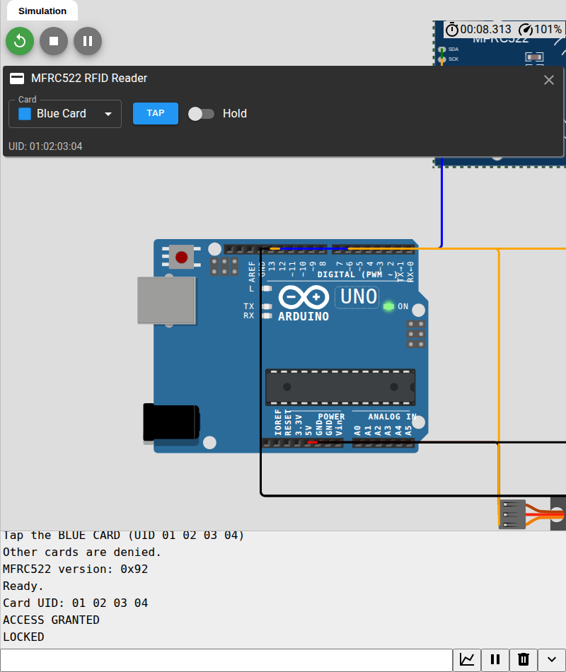

# Wokwi Simulator — RFID Door Lock

**Live project:** [https://wokwi.com/projects/480509540790761473](https://wokwi.com/projects/480509540790761473)

Versi **tanpa hardware** dari project. Ini simulator interaktif: kode Arduino benar-benar dijalankan, RC522-nya virtual, dan kartu RFID bisa di-tap dari panel Wokwi.

**Yang disimulasikan**
- Arduino Uno + MFRC522 (SPI)
- Servo sebagai pengganti latch solenoid 12V
- Buzzer untuk beep granted/denied
- LED hijau/merah untuk status
- Serial Monitor untuk log UID dan akses

## Cara menjalankan (langsung dari link)

1. Buka [project Wokwi-nya](https://wokwi.com/projects/480509540790761473).
2. Klik tombol **Run** (ikon play hijau).
3. Klik modul **MFRC522** di canvas. Panel akan muncul:
   - Card: **Blue Card**
   - Klik **TAP**, atau klik panel lalu tekan **`t`**, atau nyalakan **Hold**.
4. Serial Monitor akan menampilkan:
   ```
   Card UID: 01 02 03 04
   ACCESS GRANTED
   LOCKED
   ```
   Servo berputar ke posisi unlock, LED hijau menyala, buzzer berbunyi.

## Tes kartu ditolak

Di panel MFRC522, ganti card menjadi **Red Card** (UID `AA BB CC DD`), lalu **TAP**:

```
Card UID: AA BB CC DD
ACCESS DENIED
```

LED merah menyala, buzzer beep panjang, servo tetap di posisi locked.

## Kartu yang tersedia

| Card | UID | Status di firmware |
| --- | --- | --- |
| Blue Card | `01 02 03 04` | **Authorized** |
| Green Card | `11 22 33 44` | Ditolak |
| Yellow Card | `55 66 77 88` | Ditolak |
| Red Card | `AA BB CC DD` | Ditolak |
| NFC Tag | `04 11 22 33 44 55 66` | Ditolak (7-byte UID) |
| Key Fob | `C0 FF EE 99` | Ditolak |

Untuk mengizinkan kartu lain, ubah array di `sketch.ino`:

```cpp
const byte AUTHORIZED_UID[] = {0x11, 0x22, 0x33, 0x44};  // Green Card
```

## Catatan

- Servo di sini **bukan** solenoid asli; di build fisik, ganti servo dengan rangkaian MOSFET + solenoid 12V seperti di [README utama](../README.md).
- Wokwi menjalankan firmware Arduino yang sama; pin map-nya: RC522 `SS=10`, `RST=9`, `SCK=13`, `MOSI=11`, `MISO=12`; servo `D3`; buzzer `D2`; LED `D5`/`D6`.
- Kalau tombol **TAP** tidak merespons, klik panel lalu tekan **`t`**, atau pakai toggle **Hold**.
- `libraries.txt` disertakan untuk referensi/VS Code; di editor web cukup pakai **Library Manager**.


